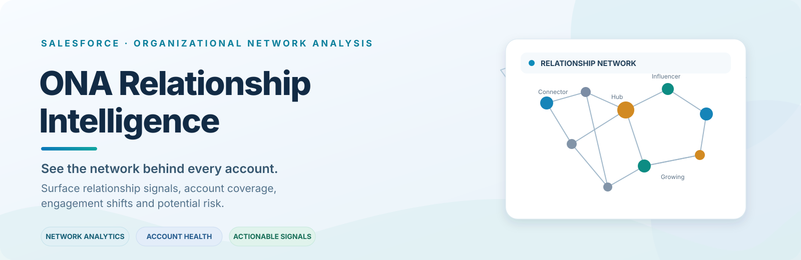
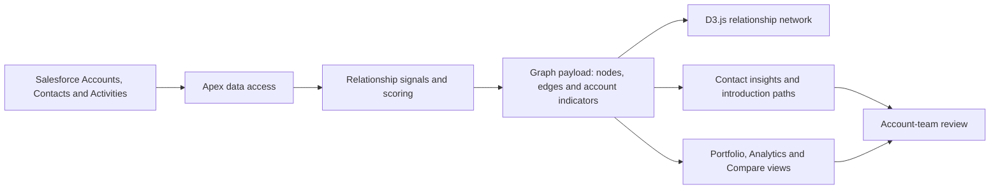

# ONA Relationship Intelligence

<p align="center"></p>

<p align="center">
  
  
  
  
</p>

<p align="center"><strong>Turn Salesforce activity into a relationship map your teams can act on.</strong><br>Understand who connects an account, where engagement is concentrated, which relationships are changing, and where to focus the next conversation.</p>

<p align="center"><a href="#-what-it-solves">What it solves</a> · <a href="#-capabilities">Capabilities</a> · <a href="#-how-it-works">Architecture</a> · <a href="#-quick-start">Quick start</a> · <a href="#-documentation">Documentation</a></p>

---

## At a glance

**ONA (Organizational Network Analysis) Relationship Intelligence** is a Salesforce-native application that uses CRM records and activity signals to build interactive relationship-network views and account-level indicators. It helps account teams move beyond static contact lists and explore the structure, coverage, and changing engagement patterns within their accounts.

| | |
|---|---|
| **Problem space** | Account relationship intelligence, stakeholder coverage, engagement patterns, and concentration risk |
| **Platform** | Salesforce |
| **User experience** | Lightning Web Components (LWC) |
| **Relationship visualization** | D3.js force-directed network |
| **Application logic** | Apex controllers and Salesforce metadata |
| **Developer tooling** | Salesforce DX, Salesforce CLI, Jest, ESLint, Prettier |
| **Project owner** | Sumit Mattey |

## Why ONA?

Enterprise buying groups rarely operate through a single contact. They span executives, business stakeholders, evaluators, influencers, champions, and users. Important signals may be distributed across Contacts, Tasks, Events, Opportunities, and other Salesforce activity.

ONA brings selected signals together so teams can investigate questions such as:

- Who connects the network? Which contacts appear to be hubs, connectors, or bridges?
- How resilient is account coverage? Is engagement concentrated around a small number of stakeholders?
- What is changing? Are activity recency, relationship decay, or engagement velocity indicators shifting?
- Where are the gaps? Which departments or seniority levels appear under-covered?
- Where could an introduction help? Are there graph paths that may suggest a warm introduction route?
- Which accounts deserve review first? How do relationship indicators compare across the portfolio?

> **Interpretation note:** ONA scores are analytical signals based on available CRM records and configured rules. They are not proof of a person's influence, sentiment, intent, or future behavior. Use them to guide human review—not to replace account-owner judgment.

## What it solves

| Challenge | ONA approach |
|---|---|
| Relationship signals are spread across CRM records | Brings contact and activity-derived signals into connected graph views |
| Teams depend on a small number of stakeholders | Highlights hubs, connectors, bridge contacts, and potential concentration risk |
| Engagement can decline without an obvious alert | Uses activity recency, decay, and velocity indicators to surface changing patterns |
| Account coverage gaps are hard to see | Summarizes coverage and department-whitespace indicators |
| Reviews happen account by account | Adds cross-account, portfolio, analytics, and side-by-side comparison views |
| Insights do not always translate into next steps | Surfaces contact-level recommendations, potential introduction paths, risk views, and campaign workflows |

## Capabilities

### 1. Interactive relationship network

The primary experience visualizes contacts as nodes and inferred relationships as edges. It uses a D3.js force-directed graph to support exploration of account connectivity.

- Visual distinctions for hubs, connectors, bridges, and other node categories.
- Edge weights and styling to communicate configured relationship-strength signals.
- Drag, zoom, highlight, and focus interactions.
- Contact selection to open a contextual insight panel.
- Search across accounts and contacts, with selected contacts brought into focus.
- Optional last-activity indicators and data-completeness cues where available.

### 2. Five account exploration views

| View | Purpose |
|---|---|
| **Network Map** | Explore the relationship structure for one account. |
| **Cross-Account** | Explore connections and potential bridge contacts across a set of accounts. |
| **Portfolio View** | Compare account coverage and relationship-health indicators across a portfolio. |
| **Analytics** | Investigate temporal patterns, seniority/power maps, impact scenarios, and risk signals. |
| **Compare** | Review two accounts side by side using selected relationship indicators. |

### 3. Relationship and account indicators

The codebase includes analytics around these themes:

- Relationship strength based on selected shared CRM signals.
- Influence, centrality, and betweenness.
- Relationship decay and engagement velocity.
- Graph clusters and breadth of connectivity.
- Shortest-path and warm-introduction exploration.
- Account coverage and departmental whitespace.
- Multi-thread concentration and configured champion-risk indicators.
- Recent activity and score-history trends where supporting metadata and history data are available.

These calculations depend on available records, data quality, selected time windows, and configured thresholds. Incomplete CRM history can produce incomplete or misleading indicators.

### 4. Contact-level insight panel

Selecting a node opens a contextual panel. Depending on available data and user permissions, it can include contact information, role and network indicators, recent activity, connected contacts, potential warm-introduction paths, and suggested next engagement areas.

### 5. Analytics workspace

- **Timeline:** Review how activity signals and network measures vary across the displayed time window.
- **Power Map:** Compare contact seniority with a chosen network measure and relationship-velocity signals.
- **Impact Simulator:** Exclude a selected contact from a modeled graph and examine how graph indicators change.
- **Risk Radar:** Focus on configured signals such as concentration, relationship decay, or limited recorded activity.

The Impact Simulator is a scenario-analysis tool. It does not predict with certainty what would happen if a stakeholder left an account or stopped responding.

### 6. Portfolio intelligence and comparison

Portfolio and comparison views help teams prioritize account reviews. They can surface relative differences in coverage, engagement momentum, network structure, and selected risk indicators. Where external account signals are configured, the portfolio experience can display related news.

### 7. Campaign workflow

The campaign panel supports selecting contacts and adding them to an existing Salesforce Campaign or creating a Campaign inline. Campaign operations change Salesforce data and must be tested with appropriate permissions, validation, and user review in the target environment.

### 8. Guided experience and usability

The application includes account/contact search, combinable filters, contextual help, a guided tour, light/dark theme support, refresh controls, and node-level cues designed to make network metrics easier to interpret.

## How it works



### Architecture by layer

| Layer | Responsibilities |
|---|---|
| **Lightning Web Components** | User experience, search and filters, view state, graph interactions, guided tour, contact details, analytics panels |
| **Apex controllers** | Query relevant Salesforce records, construct graph payloads, calculate indicators, return insights, support campaign workflows |
| **D3.js static resource** | Force-directed graph layout and network visualization |
| **Salesforce data** | Accounts, Contacts, Tasks, Events, Opportunities, Campaigns, and related CRM context used by each feature |
| **Test and quality tooling** | Apex test classes, LWC Jest tests, linting and formatting scripts |

## Technology stack

- Salesforce Platform and Salesforce DX
- Apex
- Lightning Web Components (LWC)
- D3.js
- Salesforce CLI (`sf`)
- Jest for LWC unit tests
- ESLint and Prettier

The project-level `sfdx-project.json` specifies Salesforce API version **65.0**. Individual metadata bundles may declare their own API version. Confirm compatibility with the target org and review all deployment metadata before release.

## Quick start

### Prerequisites

- Access to a Salesforce Developer Edition org or sandbox.
- Salesforce CLI installed and authenticated.
- Node.js and npm compatible with the project dependencies.
- A deployment user with the required Apex, object, field, Lightning, and static-resource permissions.

### 1. Clone the repository

```bash
git clone https://github.com/mattey2026/ona-relationship-intelligence.git
cd ona-relationship-intelligence
```

### 2. Install development dependencies

```bash
npm install
```

### 3. Authenticate to a development org

```bash
sf org login web --alias ona-dev
```

### 4. Run quality checks

```bash
npm run lint
npm run prettier:verify
```

### 5. Run LWC unit tests

```bash
npm test
```

These are the scripts configured in the repository. Successful execution depends on the local environment, dependency installation, and available tests. Review command output rather than assuming a pass result.

### 6. Validate and deploy

Start with a sandbox or development org. If the target org and CLI workflow support the validation command for this deployment, run:

```bash
sf project deploy validate --target-org ona-dev
```

Review the result, then deploy to the development org:

```bash
sf project deploy start --target-org ona-dev
```

After deployment:

1. Review and assign the appropriate permission set, if applicable.
2. Confirm CRUD/FLS and record-sharing behavior for the deployment user.
3. Verify the D3 static resource and required Apex and LWC metadata.
4. Place the exposed component on the appropriate Lightning page.
5. Test with synthetic or approved data before using the application with business-critical accounts.

**Do not deploy to production without reviewing permissions, regression tests, governor-limit behavior, and an acceptance test in the target org.**

## Security and responsible interpretation

- Review Apex sharing, CRUD/FLS enforcement, and permission-set behavior in the target org. Repository presence alone does not prove security compliance.
- Relationship indicators depend on data completeness and activity logging practices.
- Use synthetic or explicitly approved CRM data for demos, screenshots, tests, and public examples.
- Do not treat scores or thresholds as definitive judgments about individuals.
- Before publishing or deploying, confirm that no credentials, customer records, internal documents, or confidential org-specific details are included in the repository.

## Validation checklist

- [ ] Apex tests pass in a clean sandbox or scratch org.
- [ ] LWC Jest tests pass.
- [ ] ESLint and Prettier checks pass.
- [ ] Object access, field access, sharing, and permission-set behavior are reviewed.
- [ ] Empty, sparse, and incomplete account/contact data is handled gracefully.
- [ ] Duplicate and high-volume activity scenarios are tested.
- [ ] Campaign creation and membership workflows are tested with appropriate permissions.
- [ ] Graph performance and Apex governor limits are checked against representative volumes.
- [ ] Users can interpret scores, thresholds, and missing data correctly.
- [ ] A human reviewer validates recommendations before acting on them.

## Documentation

The [project Wiki](https://github.com/mattey2026/ona-relationship-intelligence/wiki) is the home for detailed guides, walkthroughs, architecture notes, and supporting documentation.

- [Repository overview](https://github.com/mattey2026/ona-relationship-intelligence)
- [Source tree](https://github.com/mattey2026/ona-relationship-intelligence/tree/main/force-app/main/default)
- [Main relationship-map LWC](https://github.com/mattey2026/ona-relationship-intelligence/tree/main/force-app/main/default/lwc/onaRelationshipMap)
- [Account relationship-map LWC](https://github.com/mattey2026/ona-relationship-intelligence/tree/main/force-app/main/default/lwc/accountRelationshipMap)
- [ONA Apex controller](https://github.com/mattey2026/ona-relationship-intelligence/blob/main/force-app/main/default/classes/ONAController.cls)
- [Campaign Apex controller](https://github.com/mattey2026/ona-relationship-intelligence/blob/main/force-app/main/default/classes/ONACampaignController.cls)
- [License](https://github.com/mattey2026/ona-relationship-intelligence/blob/main/LICENSE)

## Project status

This is a Salesforce DX codebase with substantial Apex and LWC implementation. Deployment readiness still depends on target-org metadata, data model, permissions, runtime behavior, and test results. Treat this README as a product and developer overview; validate every workflow in your own environment before relying on it for operational decisions.

## Contributing

Issues, feedback, and pull requests are welcome. Include the affected component or Apex class, reproduction steps, expected and actual behavior, and logs with sensitive information removed.

## Author

**Sumit Mattey**  
Enterprise Architecture · Salesforce · Relationship Intelligence · Applied AI

- [GitHub](https://github.com/mattey2026)
- [LinkedIn](https://www.linkedin.com/in/sumitmattey/)

---

<p align="center"><strong>See the network. Understand the risk. Strengthen the relationship.</strong></p>
